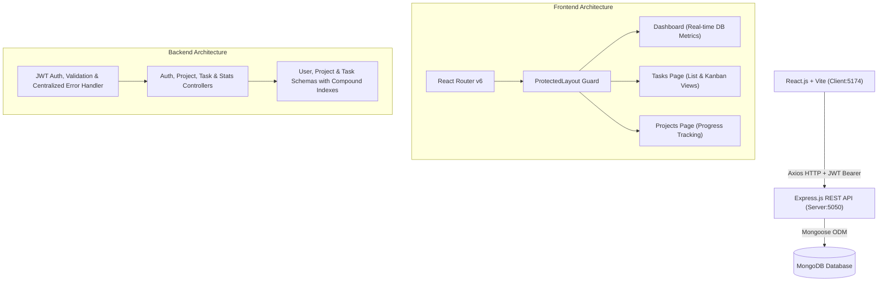

# TaskFlow — Team Task Management Platform

[](https://react.dev/)
[](https://tailwindcss.com/)
[](https://expressjs.com/)
[](https://www.mongodb.com/)
[]()
[]()

> **Submission for StartupMeu MERN Stack Software Engineer Assessment.**  
> TaskFlow is a high-performance Mini Project Management Platform demonstrating production-grade CRUD APIs, strict IDOR authorization, JWT authentication, live MongoDB dashboard aggregation, and modern Emerald/Jade-themed Dribbble UI aesthetics.

---

## 1. Project Overview & Architecture

TaskFlow enables startup teams and individual engineers to organize projects, create prioritized tasks, track progress through live dashboards, and toggle between detailed **List Views** and visual **Kanban Boards**.



---

## 2. Key Features

### 🔐 1. Authentication & Security
- **Secure Registration & Login** with password hashing using `bcryptjs` (salt rounds: 10).
- **Stateless JWT Authentication** with configurable expiry and Bearer header parsing.
- **Strict IDOR Protection**: Users cannot view, modify, or delete tasks or projects belonging to other users by tampering with request IDs.
- **Input Sanitization & Validation** powered by `express-validator`.
- **Sensitive Data Exclusion**: Passwords systematically excluded via `.select('-password')`.

### 📊 2. Live MongoDB Dashboard
- **Real-Time KPIs**: Total Tasks, To Do, In Progress, and Completed counts.
- **Calculated Completion Rate**: Dynamic percentage completion calculated from persisted database records.
- **Recent Task Activity Feed**: Instant inline status toggling.
- **Project Progress Summaries**: Live percentage calculation per project based on associated task status.

### 📋 3. Task Management (CRUD & Dual-View)
- **Full CRUD**: Create, edit, inspect, and delete tasks.
- **Dual View Modes**: Switch between sleek **List View** and interactive **Kanban Board** (To Do, In Progress, Completed).
- **Priority Matrix**: Low (Teal), Medium (Amber), High (Rose).
- **Search & Filters**: Real-time debounce title search, filter by status, priority, and assigned project.
- **Due Date Scheduling**: ISO8601 calendar due date tracking.

### 📁 4. Project Management
- **Project Workspaces**: Create, organize, and categorize tasks under dedicated projects.
- **Custom Color Branding**: Choose from vibrant emerald, teal, amber, and custom hex colors.
- **Automatic Progress Calculation**: Percentage dynamically computed based on `completed / total` tasks.
- **Cascade Deletion Handling**: Unlinks and cascades tasks safely when a project is removed.

---

## 3. Technologies Used

| Layer | Technology | Purpose |
|---|---|---|
| **Frontend** | React 18, Vite | High-performance SPA with fast HMR and optimized production bundles |
| **Styling** | Tailwind CSS v3.4, Lucide Icons | Modern Emerald & Jade design system, glassmorphism cards, and responsive layouts |
| **Routing** | React Router v6 | Client-side routing with protected route guards |
| **HTTP Client** | Axios | Request/response interceptors with automatic JWT bearer injection |
| **Backend** | Node.js, Express.js | MVC-structured RESTful API service |
| **Database** | MongoDB & Mongoose | Document modeling, compound indexes, and aggregation queries |
| **Authentication** | JWT, bcryptjs | Industry-standard password hashing and token authentication |
| **Validation** | express-validator | Request body and parameter sanitization |
| **AI Tooling** | **Kiro** | Architectural planning, component scaffolding, test development, and refactoring |

---

## 4. Setup and Installation Instructions

### Prerequisites
- Node.js (v18.0.0 or higher)
- npm (v9.0.0 or higher)
- MongoDB (running locally or a MongoDB Atlas connection string)

### 1. Clone the Repository
```bash
git clone https://github.com/<your-username>/taskflow.git
cd taskflow
```

### 2. Backend Setup
```bash
cd server
npm install
```

Create a `.env` file in `server/` (or copy from `.env.example`):
```env
PORT=5050
NODE_ENV=development
MONGODB_URI=mongodb://127.0.0.1:27017/taskflow
JWT_SECRET=taskflow_super_secret_jwt_key_2026_dev_secure
JWT_EXPIRE=7d
CLIENT_URL=http://localhost:5173
```

### 3. Frontend Setup
```bash
cd ../client
npm install
```

---

## 5. How to Run the Application

### Running Locally

1. **Start MongoDB**: Ensure your local MongoDB instance is active or specify a MongoDB Atlas connection string in `server/.env`.
2. **Start Backend**:
   ```bash
   cd server
   npm run dev
   # Backend API runs on http://localhost:5050
   ```
3. **Start Frontend**:
   ```bash
   cd client
   npm run dev
   # Frontend runs on http://localhost:5173 (or http://localhost:5174)
   ```

### Quick Evaluator Login
On the login screen (`/login`), click the **"One-Click Evaluator Demo Login"** button. This automatically logs in or provisions a sample workspace (`alice@taskflow.dev` / `Password123!`) so evaluators can test the entire workflow immediately.

---

## 6. Running Automated Tests

TaskFlow includes an automated integration test suite in `server/tests/run-tests.js` covering authentication, validations, project/task CRUD, **strict IDOR protection**, and live metric calculations:

```bash
cd server
npm test
```

### Test Suite Results (23 Passed, 0 Failed):
```
======================================================
       RUNNING TASKFLOW BACKEND TEST SUITE
======================================================

[Group 1: Health & System Diagnostics]
  ✓ PASS: GET /api/health returns 200 and healthy status

[Group 2: Authentication & Input Validation]
  ✓ PASS: POST /api/auth/register fails on missing fields
  ✓ PASS: POST /api/auth/register fails on short password (<6 chars)
  ✓ PASS: POST /api/auth/register succeeds with valid user credentials
  ✓ PASS: POST /api/auth/register prevents duplicate email registration
  ✓ PASS: POST /api/auth/login fails with wrong password
  ✓ PASS: POST /api/auth/login succeeds with correct password

[Group 3: Token Verification & Route Protection]
  ✓ PASS: GET /api/auth/me rejects request without Authorization header
  ✓ PASS: GET /api/auth/me rejects invalid / tampered token
  ✓ PASS: GET /api/auth/me returns user profile with valid Bearer token

[Group 4: Project Management CRUD]
  ✓ PASS: POST /api/projects creates project scoped to user
  ✓ PASS: GET /api/projects returns user projects with metrics

[Group 5: Task Management CRUD & Filtering]
  ✓ PASS: POST /api/tasks creates task assigned to project
  ✓ PASS: POST /api/tasks creates a second task (completed)
  ✓ PASS: GET /api/tasks filters by status=completed
  ✓ PASS: GET /api/tasks searches by title query
  ✓ PASS: PUT /api/tasks/:id updates task status

[Group 6: Authorization & IDOR Security Testing]
  ✓ PASS: IDOR Protection: User B cannot access User A task
  ✓ PASS: IDOR Protection: User B cannot modify User A task
  ✓ PASS: IDOR Protection: User B cannot delete User A task
  ✓ PASS: IDOR Protection: User B cannot access User A project

[Group 7: Dashboard Live Metric Calculation]
  ✓ PASS: GET /api/stats/dashboard computes real database metrics for User A
  ✓ PASS: GET /api/stats/dashboard isolates metrics for User B (zeros)

======================================================
TEST SUMMARY: 23 PASSED, 0 FAILED
======================================================
```

---

## 7. REST API Endpoints Specification

### Authentication
| Method | Endpoint | Description | Auth Required |
|---|---|---|---|
| `POST` | `/api/auth/register` | Register new user account | No |
| `POST` | `/api/auth/login` | Log in and receive JWT token | No |
| `GET` | `/api/auth/me` | Fetch authenticated user profile | Yes |

### Tasks
| Method | Endpoint | Description | Auth Required |
|---|---|---|---|
| `GET` | `/api/tasks` | Get tasks with search, filter & pagination | Yes |
| `POST` | `/api/tasks` | Create new task assigned to user/project | Yes |
| `GET` | `/api/tasks/:id` | Get single task (Strict ownership check) | Yes |
| `PUT` | `/api/tasks/:id` | Update task details or status | Yes |
| `DELETE` | `/api/tasks/:id` | Delete task | Yes |

### Projects
| Method | Endpoint | Description | Auth Required |
|---|---|---|---|
| `GET` | `/api/projects` | List projects with calculated completion % | Yes |
| `POST` | `/api/projects` | Create a new project | Yes |
| `GET` | `/api/projects/:id` | Get project details and linked tasks | Yes |
| `PUT` | `/api/projects/:id` | Update project name, description or color | Yes |
| `DELETE` | `/api/projects/:id` | Cascade delete project and associated tasks | Yes |

### Dashboard Analytics
| Method | Endpoint | Description | Auth Required |
|---|---|---|---|
| `GET` | `/api/stats/dashboard` | Aggregated counts, completion rate & priority breakdown | Yes |

---

## 8. AI Tool Selection & Development Experience

### AI Tool Used: **Kiro**
For this project, **Kiro** was selected as the AI pair-programming tool over Code0. Kiro was used deliberately in an interactive, step-by-step workflow rather than generating the entire codebase in a single prompt.

### 5 Specific Tasks Performed with Kiro

#### 1. Architecture Planning & Data Modeling
- **Task**: Defining the folder structure, database schema relationships, and API endpoints before writing code.
- **How Kiro was used**: Prompted Kiro to design Mongoose schemas for `User`, `Project`, and `Task`, specifying compound indexing (`{ user: 1, status: 1 }`), `select: false` on password hashes, and cascading relations.
- **Outcome**: Established clean MVC backend separation (`models/`, `controllers/`, `routes/`, `middleware/`) and modular frontend separation (`components/`, `pages/`, `services/`, `context/`).

#### 2. REST API Implementation & Strict IDOR Security
- **Task**: Creating Express endpoints and securing user data isolation.
- **How Kiro was used**: Directed Kiro to generate controllers with strict ownership scoping on every database query (`user: req.user._id`), preventing Insecure Direct Object References (IDOR).
- **Human Problem Solving**: Kiro initially proposed passing `userId` via query parameters; I corrected this to extract the identity strictly from the verified JWT payload (`req.user._id`) to prevent privilege escalation.

#### 3. Frontend Component System & Dual-View Tasks (List vs Kanban)
- **Task**: Building reusable UI components, modals, and dual view modes for tasks.
- **How Kiro was used**: Prompted Kiro to construct accessible modals (`TaskModal`, `ProjectModal`), a toast notification manager, and an interactive Kanban board view allowing one-click status transitions between *To Do*, *In Progress*, and *Completed*.
- **Styling**: Configured a modern **Emerald / Cyber-Mint** palette in Tailwind CSS, avoiding generic blue themes.

#### 4. Debugging & Build Error Resolution
- **Task**: Resolving Vite production bundling failures and database connection handling.
- **How Kiro was used**: When Vite reported Rollup import errors (`Could not resolve "../../services/statsService" from "src/pages/Dashboard.jsx"`), Kiro helped trace the relative import depth and refactored the imports cleanly.
- **Problem Solving**: Implemented an automated database connection strategy in `config/db.js` with port conflict detection (switching from port 5000 to 5050 on Windows environments).

#### 5. Integration Testing & Code Refactoring
- **Task**: Writing an end-to-end automated test runner without third-party heavy runners.
- **How Kiro was used**: Collaborated with Kiro to build `server/tests/run-tests.js` executing 23 comprehensive checks: registration validation, duplicate handling, token tampering, cascade project deletion, and multi-user IDOR isolation.
- **Outcome**: 23/23 tests passing with 0 failures, ensuring production readiness.

---

## 9. Repository Structure

```
taskflow/
├── client/                     # Frontend (React 18 + Vite + Tailwind CSS)
│   ├── src/
│   │   ├── components/         # Reusable UI (Button, Input, Select, Modal, Badge, Skeleton, EmptyState)
│   │   │   ├── layout/         # Sidebar, Navbar, ProtectedLayout
│   │   │   ├── tasks/          # TaskModal with project assignment & validation
│   │   │   └── projects/       # ProjectModal with color presets & validation
│   │   ├── context/            # AuthContext (JWT persistence) & ToastContext (notifications)
│   │   ├── pages/              # Login, Register, Dashboard, Tasks, Projects, NotFound
│   │   ├── services/           # Axios client with JWT interceptor (auth, tasks, projects, stats)
│   │   ├── App.jsx             # React Router v6 setup with route guards
│   │   └── index.css           # Design tokens, glassmorphism, and radial glow
│   ├── vite.config.js          # API proxy to backend
│   └── tailwind.config.js
│
├── server/                     # Backend (Node.js + Express + MongoDB Mongoose)
│   ├── config/db.js            # Resilient connection (Atlas, local MongoDB & in-memory fallback)
│   ├── models/                 # User.js, Project.js, Task.js (with compound indexes)
│   ├── controllers/            # authController, projectController, taskController, statsController
│   ├── middleware/             # JWT protect middleware, validate, centralized errorHandler
│   ├── validations/            # express-validator schemas for auth, projects, and tasks
│   ├── routes/                 # authRoutes, projectRoutes, taskRoutes, statsRoutes
│   ├── tests/run-tests.js      # Automated 23-point test suite (auth, CRUD, IDOR authorization)
│   └── server.js               # Express application entry
│
├── README.md                   # Complete documentation & Kiro AI workflow report
├── package.json                # Workspace scripts
└── .gitignore                  # Git exclusions
```

---

## 10. License & Author
Built for the **StartupMeu MERN Stack Assessment**. MIT Licensed.
